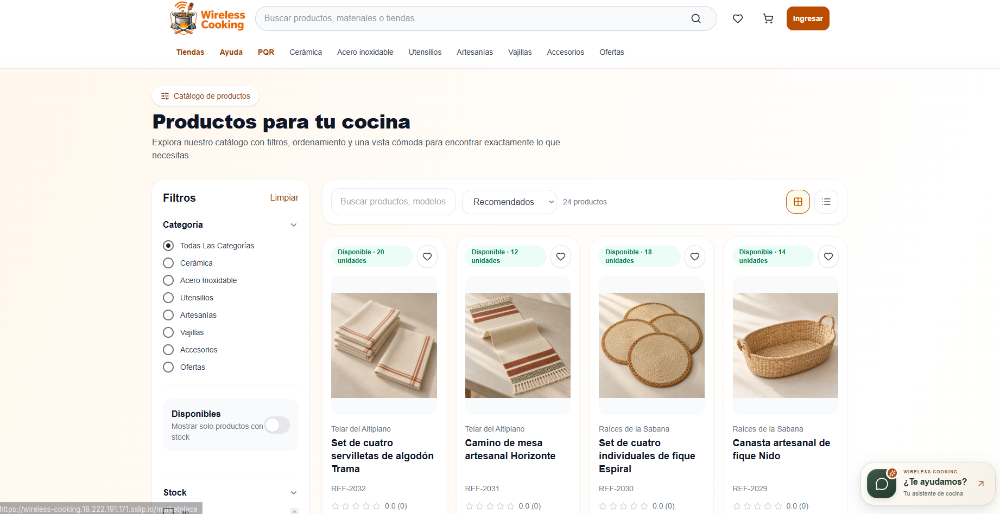

# Wireless Cooking

[](https://github.com/horzioncode777/wireless-cooking/actions/workflows/check.yml)

Marketplace de utensilios de cocina y artesanías de la Sabana de Cundinamarca. Conecta compradores y comerciantes mediante un catálogo por tienda, carrito, pedidos, pagos, seguimiento y atención posventa.

**Proyecto de grado de Juan Esteban Torres Delgado y Valentina González Gordillo.**

[Autores](AUTHORS.md) · [Arquitectura e integraciones](docs/ARQUITECTURA.md) · [Despliegue](docs/DESPLIEGUE.md) · [Presentación del proyecto](https://portafolio-jt.vercel.app/proyectos#grado)



## Funcionalidades

| Perfil | Funciones |
| --- | --- |
| Comprador | Catálogo, búsqueda y filtros, favoritos, carrito, pedidos, checkout, recibos, seguimiento, reseñas y PQR |
| Comerciante | Perfil de tienda, galerías, productos, existencias, pedidos, reportes de ventas y módulos de cobro por vendedor |
| Administrador | Gestión de cuentas, tiendas, catálogo, pedidos, estados logísticos, reportes y atención de PQR |

- Reservas de stock con transacciones, control de concurrencia e idempotencia de pedidos.
- Totales calculados en el servidor y comprobación de eventos de Wompi.
- Acceso por roles, recuperación de contraseña por correo y revocación de sesiones.
- Actualización del catálogo mediante SSE, con consulta periódica de respaldo.
- Recomendaciones locales por contenido y actividad; asistente con ayuda local y proveedor IA opcional.
- Imágenes locales o Cloudinary, datos de demostración y construcción para servir la web desde Express.

El catálogo de ejemplo usa tiendas y compradores ficticios. Las imágenes de demostración son recursos sintéticos del proyecto; no representan establecimientos ni personas reales.

## Tecnologías

React 19, Vite 8, Tailwind CSS 4, React Router, Node.js 22, Express 4 y PostgreSQL 17. El backend integra JWT, bcrypt, Wompi, correo y almacenamiento opcional en Cloudinary. Las versiones resueltas se conservan en los archivos `package-lock.json`.

## Requisitos

- Node.js **22.12 o posterior dentro de la rama 22.x**, con npm.
- PostgreSQL **17**, con una base vacía para el proyecto.
- Git. Docker es opcional para preparar la imagen de despliegue.

No se incluyen bases de datos, credenciales, claves de servicios ni archivos subidos por usuarios. La configuración de ejemplo permite trabajar sin servicios externos usando pagos de demostración.

## Instalación local

```powershell
git clone https://github.com/horzioncode777/wireless-cooking.git
cd wireless-cooking
Copy-Item backend/.env.example backend/.env
Copy-Item frontend/.env.example frontend/.env
```

En macOS o Linux usa `cp` para copiar los archivos. Crea una base PostgreSQL vacía llamada `wireless_cooking` y configura `DB_HOST`, `DB_PORT`, `DB_NAME`, `DB_USER` y `DB_PASSWORD` en `backend/.env`. Genera un valor para `JWT_SECRET` con:

```powershell
node -e "console.log(require('node:crypto').randomBytes(48).toString('hex'))"
```

Desde la raíz del repositorio:

```powershell
npm --prefix backend ci
npm --prefix frontend ci
npm --prefix backend run db:migrate
```

### Datos de demostración

En una base local nueva, con `NODE_ENV=development` y `PAYMENT_MODE=demo`, ejecuta:

```powershell
cd backend
node scripts/seed-demo.js
cd ..
```

El script crea cuentas ficticias con contraseñas aleatorias y guarda los accesos en `ACCESOS.local.md`, excluido de Git. Los scripts `db:seed-sabana`, `db:seed-buyers` y `db:seed-companies` preparan colecciones de demostración adicionales; revisa su alcance antes de ejecutarlos en una base con datos.

Para crear una cuenta administrativa propia, define `ADMIN_EMAIL` y `ADMIN_PASSWORD` de al menos 12 caracteres en el entorno y ejecuta `npm --prefix backend run admin:create`. No guardes esos valores en el código.

### Iniciar

En dos terminales, desde la raíz:

```powershell
npm --prefix backend run dev
```

```powershell
npm --prefix frontend run dev
```

Abre [http://localhost:5173](http://localhost:5173). La API usa el puerto 6001. En desarrollo, la configuración de API del frontend resuelve el backend local; usa `VITE_API_URL` si necesitas otro origen.

## Comprobar cambios

Configura una **base de pruebas independiente**, con un usuario que pueda crear y eliminar esquemas. Las pruebas integrales usan esquemas `test_*` aislados. No uses credenciales de producción para ejecutar pruebas.

```powershell
npm --prefix backend test
node --test frontend/tests/*.test.js
npm --prefix frontend run lint
npm --prefix frontend run build
```

GitHub Actions repite estas comprobaciones con PostgreSQL 17. Las pruebas cubren roles, aislamiento entre tiendas, stock, pedidos, pagos de demostración, firmas de eventos, recuperación de cuenta, perfil, PQR, notificaciones y recibos. No realizan cobros reales.

## Estructura

```text
backend/
  src/                 API, controladores, rutas, permisos y servicios
  db/schema.sql        Esquema y migración de la base de datos
  scripts/             Administración, datos de demostración y verificación
  tests/               Pruebas unitarias e integrales
  data/                Catálogos y perfiles ficticios de demostración
  demo-assets/         Imágenes y logotipos del catálogo de ejemplo
frontend/
  src/                 Páginas, componentes, hooks, rutas y servicios
  public/              Identidad visual y recursos públicos
  tests/               Pruebas de lógica del frontend
shared/                Información pública y utilidades compartidas
scripts/               Construcción de producción
docs/                  Presentación, arquitectura y despliegue
.github/workflows/     Comprobaciones automáticas
Dockerfile             Imagen de aplicación para despliegue
```

Edita las páginas en `frontend/src/pages/` y los componentes en `frontend/src/components/`. La API está en `backend/src/routes/` y `backend/src/controllers/`; las reglas de negocio se encuentran en `backend/src/services/`. Los cambios de esquema se mantienen en `backend/db/schema.sql`.

## Integraciones y despliegue

La aplicación puede usar Wompi Sandbox, Gmail, Cloudinary y un proveedor IA configurado en el backend. El repositorio no incluye cuentas ni claves de esos servicios. Las recomendaciones locales y la ayuda local funcionan sin una clave IA.

Para construir la web con la API en el mismo origen:

```powershell
node scripts/build-production.mjs
```

Después configura `SERVE_FRONTEND=true`, `NODE_ENV=production` y `FRONTEND_URL` con la dirección HTTPS del sitio. El backend sirve el frontend compilado. Consulta [DESPLIEGUE.md](docs/DESPLIEGUE.md) para PostgreSQL, HTTPS, almacenamiento y configuración externa.

El soporte de Wompi no equivale a una habilitación comercial: una publicación con pagos reales necesita su configuración, validación y operación propias. Los módulos de asistencia y recomendaciones son funciones académicas en evolución.

## Autoría y derechos

La autoría es compartida entre **Juan Esteban Torres Delgado y Valentina González Gordillo**. Se conserva el código de la versión final del proyecto; esta copia de publicación organiza la documentación y excluye la configuración privada y los datos operativos. Los originales locales permanecen separados.

Todos los derechos del código y los recursos originales quedan reservados a sus autores. Las dependencias y marcas conservan sus licencias. Consulta [LICENSE](LICENSE).
